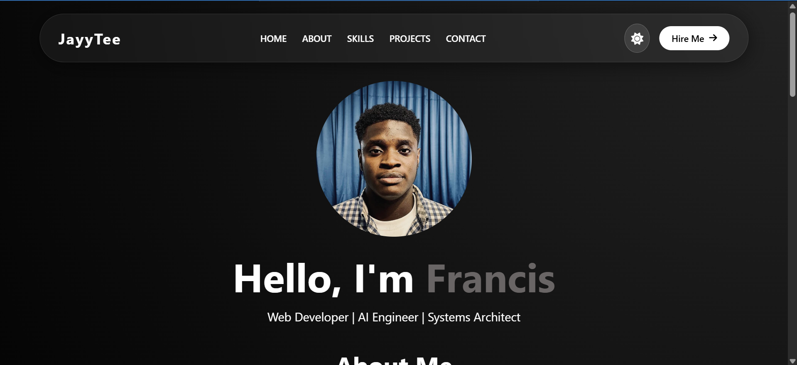
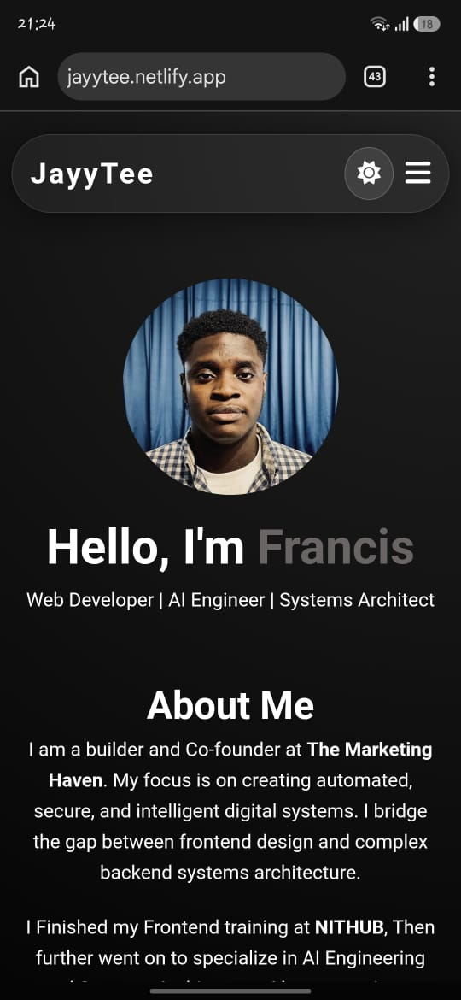

# JayyTee | Personal Portfolio

A modern, responsive personal portfolio website built with Vanilla HTML, CSS, and JavaScript. It features a premium "Liquid Glass" (Glassmorphism) aesthetic with a fully functional dark/light mode toggle and dynamic project rendering.

## Live Demo
[View Live Site](jayytee.netlify.app)

## Screenshots

### Desktop View

### Mobile View

## Features

### Core Features
- Fully Responsive Design: Optimized for mobile, tablet, and desktop using CSS Flexbox/Grid and Media Queries.
- Dynamic Projects Section: Projects are rendered using a JavaScript array and the `.map()` method, fulfilling data-driven requirements.
- Contact Section: Direct mail, LinkedIn, and WhatsApp integrations.
- Mobile Navigation: Hamburger menu with smooth scrolling.

### Extra Features (For Higher Grade)
- Dark/Light Mode: Persisted using `localStorage` and CSS Variables (`:root`).
- Custom Preloader: A text-scramble animation built with Vanilla JavaScript.
- Image Lightbox: A custom modal that allows the profile picture to be viewed in full screen.
- 3D Coin-Flip Animation: CSS `@keyframes` applied to the profile picture on page load.
- Glassmorphism UI: Advanced CSS using `backdrop-filter: blur()`.

## 🛠️ Tech Stack
- HTML5
- CSS3 (Flexbox, Grid, Variables, Animations)
- Vanilla JavaScript (ES6+)
- FontAwesome (Icons)

## 🚀 Setup & Installation
To run this project locally:
1. Clone the repository: `git clone https://github.com/Tripple-svg/portfolio-web.git`
2. Navigate to the project folder.
3. Open `index.html` in your web browser.

## 🧠 What I Learned
Building this project strengthened my understanding of CSS custom properties (`:root`), DOM manipulation using Vanilla JS, and handling responsive layout conflicts across different screen sizes.